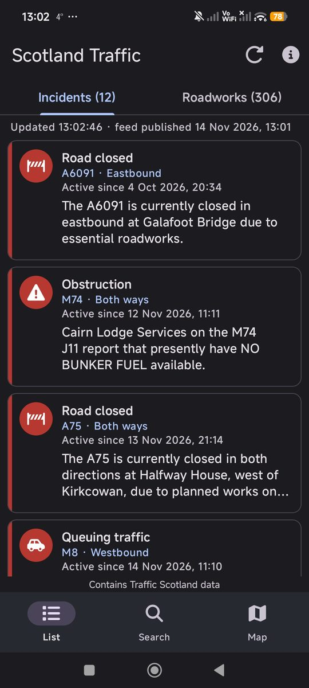
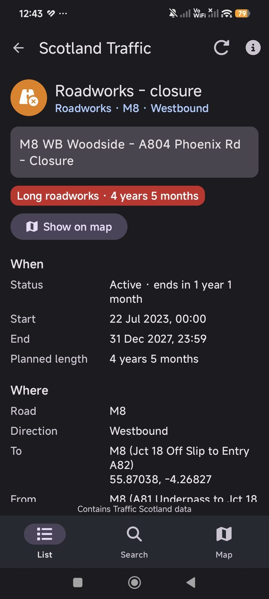
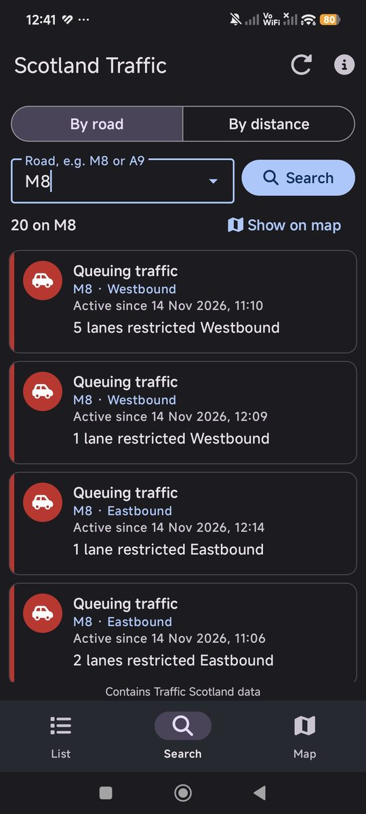
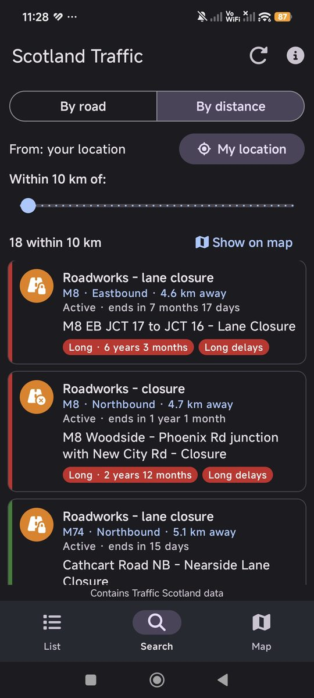
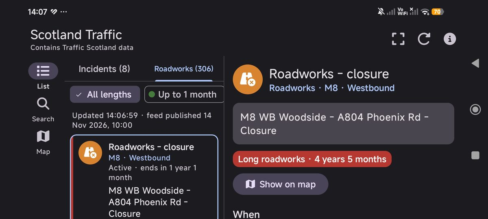
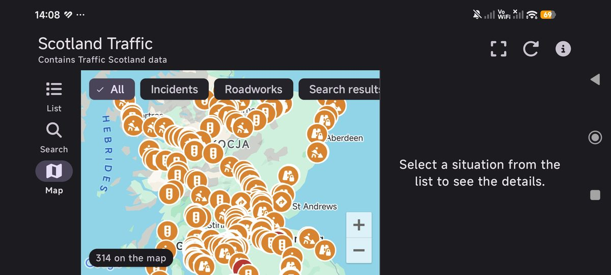
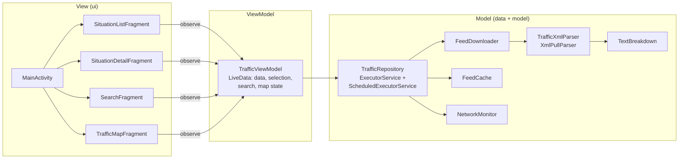

# Scotland Traffic

An Android app that shows current **incidents** (unplanned events) and **roadworks**
on Scottish trunk roads and motorways. The data comes from the Traffic Scotland
DATEX II feeds and is read with the **XmlPullParser**.

*Mobile Platform Development coursework. Java and XML only. Contains Traffic Scotland data.*

<p>
  
  
  
  
</p>
<p>
  
  
</p>

*Screenshots taken on a phone with live Traffic Scotland data (14 November 2026).*

## Features

| Feature | How it works in the app |
| --- | --- |
| List of situations | Two tabs, **Incidents** and **Roadworks**, with counts. Each card shows the icon, type, road, direction and the `generalPublicComment`. |
| Details | Tap a card to see everything in the feed: description, start/end time and length, road, direction, "from" and "to" points with coordinates, lanes, delays, works type, source, status and reference. |
| Colour-coded roadworks | Green: up to 1 month. Amber: 1–12 months. Red: over 12 months. Shown as a strip, a badge and on the map line of the selected roadworks, with a legend above the list. |
| Search by road | Type a road (suggestions of all roads in the data). `M8`, `m8`, `A74(M)` and `a74m` all work. Roads named only in the comment are found too. |
| Search by distance | Slider from 5 to 200 km from the phone's approximate (coarse) location, or from a default point (Glasgow city centre) if location is not allowed. Results are sorted nearest first and show the distance. |
| Icons | 12 different icons for kinds of situations (road closed, lane restriction, queuing traffic, accident, obstruction, weather, roadworks closure, lane closure, traffic lights, diversion, ...). |
| Map | Google map with a marker for each situation; the "from–to" stretch of the selected one is drawn as a line. Filters: All, Incidents, Roadworks, Search results (many selected situations at once). "Show on map" on the details screen zooms to one situation. |
| Portrait and landscape | Two different `activity_main.xml` layouts. Portrait: bottom navigation, one pane. Landscape: navigation rail, list/search/map and details side by side. Everything on screen is kept when the phone is rotated. |
| Automatic update | Data is downloaded when the app starts and then every 60 minutes while the app is on screen, and again when the connection comes back. Manual refresh in the toolbar. |
| No internet | The last download is saved on the phone and shown with a banner ("No internet connection – showing data saved at ..."). Errors such as a wrong key are explained and never crash the app. |

## Architecture

Single Activity + Fragments, organised with **MVVM** (Model – View – ViewModel).



| Package | Contents |
| --- | --- |
| `model` | Data classes: `Situation`, `Validity`, `Impact`, `RoadLocation`, `LocationPoint`, `FeedState`, `TrafficData`, `SearchOrigin` |
| `data` | `TrafficRepository`, `FeedDownloader`, `TrafficXmlParser`, `TextBreakdown`, `FeedCache`, `NetworkMonitor`, `DeviceLocation`, `AppConfig` |
| `viewmodel` | `TrafficViewModel` (shared by all fragments, survives rotation) |
| `ui` | Fragments, `SituationAdapter` (RecyclerView), `SituationStyle`, `DisplayFormat` |

### Parsing
* The feed is downloaded into a **String**, and `TrafficXmlParser` reads that String with the `XmlPullParser`.
* The parser keeps a stack of open element names, because the same tag (for example `<value>`) is used for the comment, the source name and the road names.
* Every field of a situation record is stored: header, times, source, validity, impact, comment, locations (with all their names and coordinates), compliance option and the sub-type. Unknown elements are ignored, so new data in the feed does not crash the app.
* `TextBreakdown` then splits the text with String methods and regular expressions: road number, comment parts, expanded short forms (`TTL` → "Temporary traffic lights") and the kind of situation.

### Threads
* All downloading, parsing and file work runs on a background `ExecutorService` in `TrafficRepository`.
* Results reach the screen only through `LiveData.postValue()`. There is no `runOnUiThread` and no `AsyncTask`.
* A `ScheduledExecutorService` repeats the update at a fixed interval.

## How to build and run

1. Open the project in Android Studio (min SDK 26, Android 8.0).
2. Add your keys to **`local.properties`** in the project folder. This file is **not** uploaded to GitHub:
   ```properties
   TS_CLIENT_ID=your_traffic_scotland_client_id
   TS_CLIENT_KEY=your_traffic_scotland_client_key
   MAPS_API_KEY=your_google_maps_key
   ```
   Optional settings for **debug builds only** (release builds always use live data and update every 60 minutes):
   ```properties
   USE_SAMPLE_DATA=true      # use the example XML files instead of the live feed
   REFRESH_MINUTES=2         # shorter update interval for the demo
   ```
3. Run the app on a phone or emulator.

The keys are copied into `BuildConfig` and the manifest at build time, so they never appear in the source code.

## Tests

* **Unit tests** (`app/src/test`): text breakdown, road names, duration colour bands, distance.
* **Instrumented tests** (`app/src/androidTest`, run on a phone): the parser on the example XML files (4 incidents, 405 roadworks), empty and broken input, unknown elements.
* Manual tests with expected and actual results are in the separate test document.

## Credits

* **Data:** Contains Traffic Scotland data (DATEX II feeds, Transport Scotland).
* **Icons:** [Font Awesome Free](https://fontawesome.com) 7.3.1 by Fonticons, Inc., licensed under
  [CC BY 4.0](https://creativecommons.org/licenses/by/4.0/). The icons were converted to Android vector
  drawables, resized and recoloured. The source and licence are also in the header of each icon file
  and in the app's **About** screen.
* **Map:** Google Maps SDK for Android.
