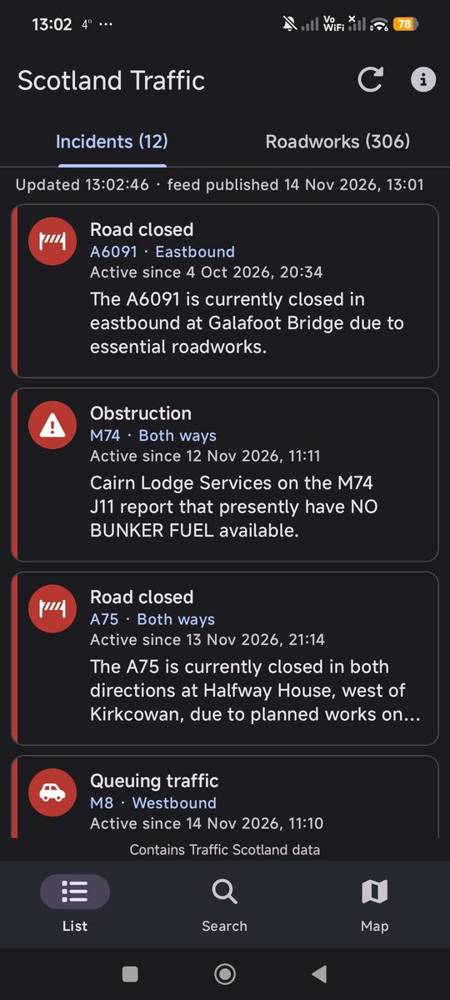
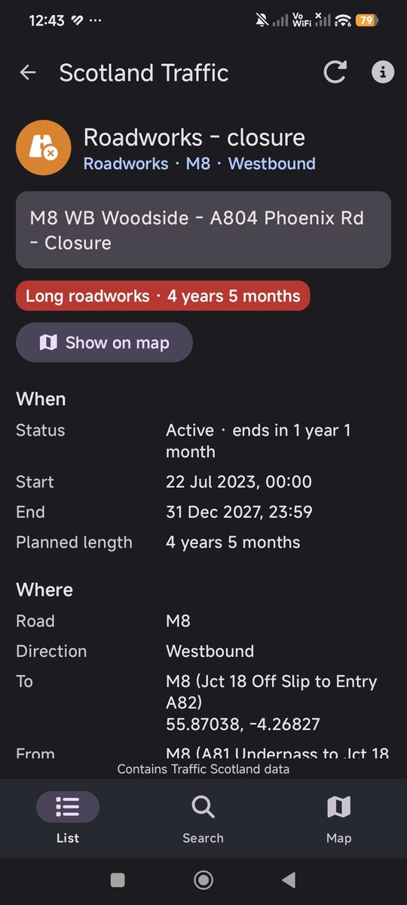
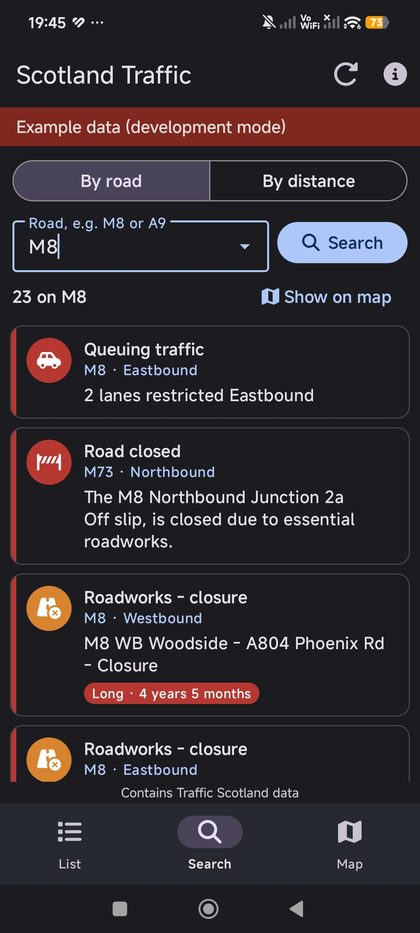
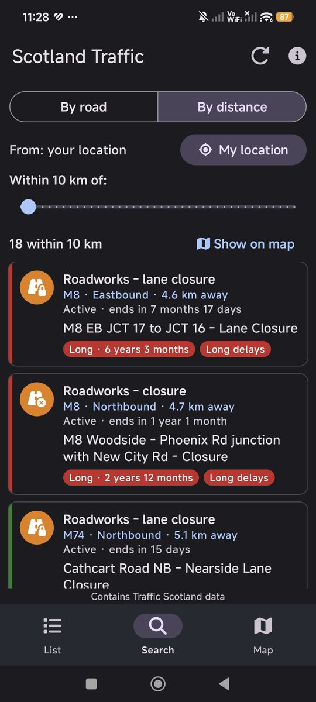
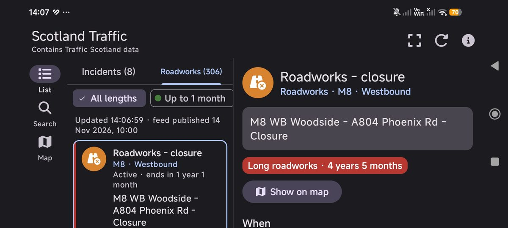
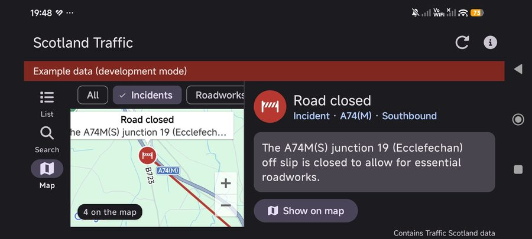

# Scotland Traffic

This is my Android app for the Mobile Platform Development coursework at Glasgow
Caledonian University. It shows current incidents and roadworks on Scottish trunk
roads and motorways, using the Traffic Scotland DATEX II feeds.

The app is written in Java and XML in Android Studio.

<p>
  
  
  
  
</p>
<p>
  
  
</p>

*Screenshots from my phone with live data, 14 November 2026.*

## What the app does

- **List** - two tabs, Incidents and Roadworks. Each card shows an icon, the type,
  the road and the public comment from the feed.
- **Details** - tap a card to see everything the feed gives: times, road, direction,
  start and end points, delays, lanes and so on.
- **Colours for roadworks** - green for short works (up to 1 month), amber for
  medium (1 to 12 months) and red for long (over 12 months).
- **Search by road** - type a road like `M8` or `A74(M)`. The app suggests roads
  from the data.
- **Search by distance** - choose a distance from 5 to 200 km. The app uses the
  phone's approximate location, or Glasgow city centre if location is not allowed.
- **Map** - a Google map with a marker for each situation. You can show all,
  only incidents, only roadworks or your search results.
- **Portrait and landscape** - each orientation has its own layout. In landscape
  the list and the details are side by side.
- **Updates** - the data is downloaded when the app opens, then every 60 minutes,
  and again when the internet comes back. There is also a refresh button.
- **No internet** - the app shows the last saved data with a message, so it still
  works offline.

## How it is built

I used one Activity with Fragments and the MVVM pattern:

- `model` - the classes that hold the data (`Situation`, `Validity`, `Impact`, ...)
- `data` - downloading, parsing and saving the feeds (`TrafficRepository`,
  `TrafficXmlParser`, `FeedDownloader`, ...)
- `viewmodel` - `TrafficViewModel`, shared by all screens, so nothing is lost when
  the phone is rotated
- `ui` - the screens (list, details, search, map)

The XML is downloaded into a String and read with the **XmlPullParser**.
All the downloading and parsing runs on a background thread (`ExecutorService`),
and a `ScheduledExecutorService` runs the automatic update.

## How to run it

1. Open the project in Android Studio.
2. Add your own keys to the file `local.properties` in the main project folder.
   This file is not on GitHub, so my keys are not shared.
   ```properties
   TS_CLIENT_ID=your_traffic_scotland_client_id
   TS_CLIENT_KEY=your_traffic_scotland_client_key
   MAPS_API_KEY=your_google_maps_key
   ```
3. Run the app on a phone or an emulator (Android 8.0 or newer).

If you want to try the app without the live feed, you can also add
`USE_SAMPLE_DATA=true`. The app will then use the two example XML files from the
coursework. This only works in debug builds.

## Tests

- Unit tests are in `app/src/test`.
- Tests for the parser that run on a phone are in `app/src/androidTest`.
- All my manual tests, with expected and actual results, are in the Word document
  I submitted.

## Credits

- **Data:** Contains Traffic Scotland data (DATEX II feeds, Transport Scotland).
- **Icons:** [Font Awesome Free](https://fontawesome.com) by Fonticons, Inc., under the
  [CC BY 4.0](https://creativecommons.org/licenses/by/4.0/) licence. I changed them
  into Android vector files and changed their colours.
- **Map:** Google Maps SDK for Android.
